  

  
  
  

  <a href="#-sobre">Sobre</a> •
  <a href="#-como-o-lab-é-organizado">Organização</a> •
  <a href="#-índice-de-estudos">Índice</a> •
  <a href="#-tecnologias">Tecnologias</a>

---

## 📌 Sobre

O **Python Learning Lab** é o meu caderno de estudos e laboratório pessoal: tudo o que eu aprendo, pratico e experimento usando Python vem parar aqui.

Não há um tema único. O que une tudo é a linguagem. Aqui convivem estudos da faculdade, cursos que estou fazendo, projetos avulsos e experimentos que surgem pelo caminho. O foco principal é **saúde e negócios**, mas o laboratório está aberto a qualquer ideia que valha ser explorada com código.

Cada estudo vive na sua própria pasta, com README próprio explicando o contexto, a abordagem e os resultados.

---

## 🧭 Como o lab é organizado

| Categoria | O que entra |
| :--- | :--- |
| 🎓 **Faculdade** | Estudos e exercícios aplicados que nascem das disciplinas do curso. |
| 📚 **Cursos** | Anotações e projetos de cursos e formações (como as carreiras da Alura). Cada curso tem seu próprio repositório ou pasta, com README dedicado. |
| 🧪 **Projetos avulsos** | Experimentos e ideias soltas, sem vínculo com curso ou disciplina. Basta usar Python. |

---

## 🗂️ Índice de estudos

| Estudo | Categoria | Descrição | Conceitos | Status |
| :--- | :---: | :--- | :--- | :-: |
| 🏥 [UTI Vital Signs Monitor](./01_numpy_uti_analytics) | 🎓 Faculdade | Análise vetorizada de frequência cardíaca (BPM) e triagem automática de taquicardia em UTI. | `ndarray 2D`, `axis`, máscaras booleanas, `np.where` | ✅ Concluído |
| 📚 Carreira Python (Alura) | 📚 Cursos | Anotações e projetos da formação em Python. | A definir | 🔜 Em breve |

> O índice cresce a cada novo estudo adicionado.

---

## 💻 Tecnologias

Ferramentas que já passaram por aqui (a lista cresce junto com o lab):

---

## 👩‍💻 Autora

**Kathellyn Kauany**
Aprendendo, construindo e registrando tudo em Python.

---

  <code>$ status: learning &amp; building</code>

