  

# 📚 Cursos

Anotações, exercícios e projetos de cursos e formações em Python. Cada curso ganha a sua própria pasta, com README dedicado explicando o que foi estudado e os projetos desenvolvidos.

---

## 🗂️ Cursos

| Curso | Plataforma | Descrição | Status |
| :--- | :---: | :--- | :-: |
| Carreira Python | Alura | Formação em Python, da lógica de programação às aplicações avançadas. | 🔜 Em breve |

---

  <a href="../README.md">← Voltar ao Python Learning Lab</a>

