  

# 🧪 Projetos avulsos

Experimentos e ideias soltas, sem vínculo com curso ou disciplina. Se foi feito em Python e valeu a pena registrar, entra aqui.

---

## 🗂️ Projetos

| Projeto | Descrição | Conceitos | Status |
| :--- | :--- | :--- | :-: |
| *Nenhum projeto ainda* | O primeiro experimento vai aparecer aqui. | | 🔜 Em breve |

---

  <a href="../README.md">← Voltar ao Python Learning Lab</a>

